# 도면3D (blueprint3d)

노트북에서 쓰는 기계 부품 CAD입니다. 지금은 브라우저에서 돌고, **설치형 앱(윈도우·맥)은 12단계**, iPad·안드로이드는 그 뒤(23단계)에 같은 코드로 나옵니다.
**2D 3면도를 그리면 3D 모델이 자동으로 만들어지고**, 3D는 다시 **2D 도면(SVG·DXF)**으로 뽑을 수 있습니다.
설계 오류는 그리는 즉시 **규칙 기반 검사**가 잡아 줍니다.

**최종 목표**: 지금은 따로 쓰는 툴들 — 부품 설계(SolidWorks·Fusion), 2D 제도(AutoCAD), 게임용 3D 모델링(Blender), 제조 출력(슬라이서·CAM) — 을
**하나로 이은 통합 도구**. 큰 프로젝트라 기반부터 순서대로 쌓습니다 → [전체 계획](docs/ROADMAP.md) · [구조](docs/ARCHITECTURE.md) · [결정 기록](docs/DECISIONS.md) · [아이디어 함](docs/IDEAS.md) · [완료 기록](docs/CHANGELOG.md)

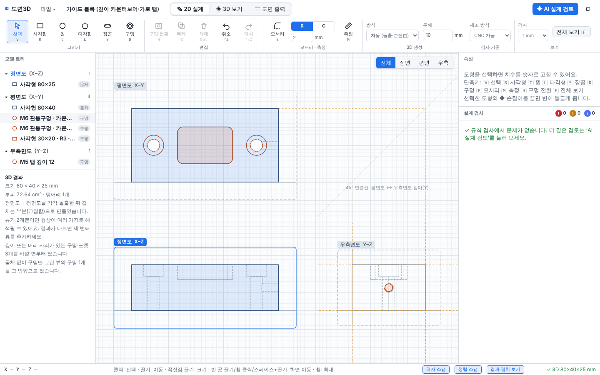

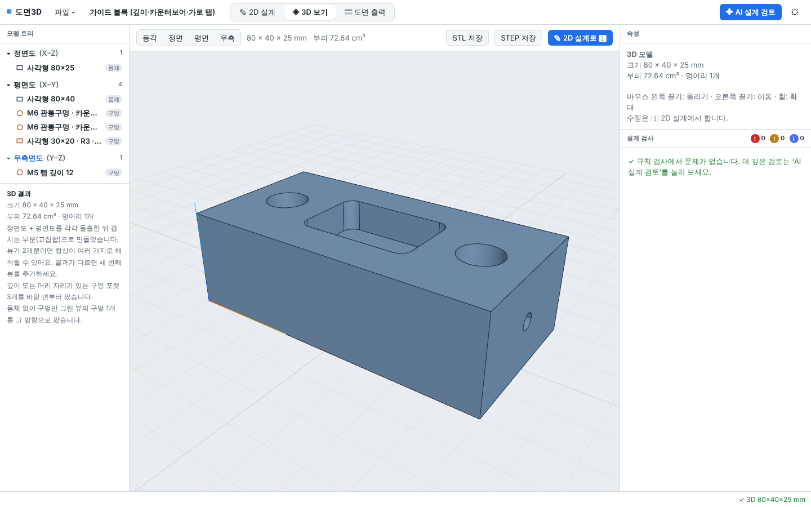

## 기능

### 2D → 3D
- **화면은 세 가지 모드**: 위쪽 탭(또는 <kbd>1</kbd> <kbd>2</kbd> <kbd>3</kbd>)으로 바꿉니다.
  - **2D 설계**: 큰 제도판 한 장에 정면도(왼쪽 아래)·평면도(위)·우측면도(오른쪽)를 실제 도면처럼 배치(3각법).
    평면도와 정면도는 X가, 정면도와 우측면도는 Z가 **항상 일직선**이고, 오른쪽 위 45° 선이 평면도와 우측면도의 Y를 이어 줍니다.
    한 뷰에서 그리는 점이 다른 뷰에 투영선으로 보여요. 오른쪽 위 [전체 | 정면 | 평면 | 우측]으로 한 뷰만 크게 볼 수 있습니다.
  - **3D 보기**: 3D 모델을 화면 가득히. 시점 버튼, STL/STEP 저장
  - **도면 출력**: 3D에서 자동으로 만든 3면도(SVG·DXF·인쇄)
- **그리기 도구**: 사각형(R), 원(C), 다각형(L), 장공(S), 선택/이동(V)
  - **모서리(E)**: 꼭짓점 클릭으로 R(둥글게) 또는 C(모따기), Shift+클릭은 모든 꼭짓점
  - **변 휘기**: 선택한 도형의 변 가운데 ◆ 손잡이를 끌면 원호가 됩니다
  - **대칭 복사 · 직선 배열 · 원형 배열**: 속성 패널의 ‘복사’ 칸
  - **측정(M)**: 두 점 사이 거리·각도·가로/세로 성분
  - **구멍(D)**: 규격 구멍 — 볼트 관통(정밀·보통·거침)·탭, M2~M20, 카운터보어·카운터싱크, 드릴 끝. 표준 치수 자동
  - **깊이**: 구멍·포켓마다 관통 또는 깊이(mm). 가장자리에 걸치면 단차. 몸체 없는 뷰에 그린 구멍은 그 방향으로 뚫는 가로 구멍
  - **결과 겹쳐 보기**: 3D 결과를 각 2D 창에 흐리게 겹쳐 보여 줘서 다른 뷰 기준으로 위치를 잡기 쉬움
  - **치수 직접 입력**: 그리는 중에 숫자를 치면 입력창이 뜹니다. 사각형 `40,20`, 원 `10`(지름), 장공 `20,6`(중심거리,폭), 다각형 `30<90`(길이<각도) 또는 `Δx,Δy`
  - **스냅**: 격자 스냅(G), 정렬 스냅(A)은 다른 도형과 다른 뷰의 꼭짓점·중심에 맞춰 붙고, Shift는 수평·수직·45°로 고정합니다.
  - 몸체 안에 그리면 자동으로 **구멍**이 됩니다(H로 전환).
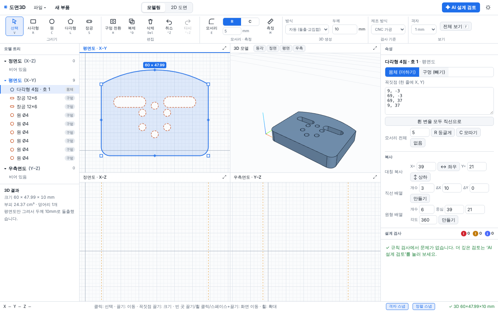

- **자동 3D 생성** (OpenCascade CAD 엔진)
  - 뷰 1개: 두께만큼 돌출
  - 뷰 2~3개: 각 뷰를 관통 돌출한 뒤 교집합
  - 회전체: 정면도 단면을 Z축 중심으로 회전
  - 깊이·머리 자리가 있는 구멍과 포켓은 3D를 만든 뒤 바깥 면부터 판다
  - 구멍이 많아도 빠르게: 몸체 안의 원·장공 구멍은 단면의 안쪽 경계로 바로 넣는다 (구멍 126개 판 약 3초)
- **변수와 식**: `L = 80`, `t = 6` 같은 변수를 만들고 치수 칸에 `L`, `L/2`, `L-e`처럼 식을 넣으면, 변수 하나만 바꿔도 크기·구멍 위치·3D가 함께 바뀝니다
  - **치수 잠금(🔒)**: 잠근 치수는 끌어도 안 바뀜 · **도면 위 치수**: 선택한 도형의 치수 숫자를 눌러 바로 고치기
  - **가운데 맞춤**, **거의 수평·수직인 변 바로잡기**

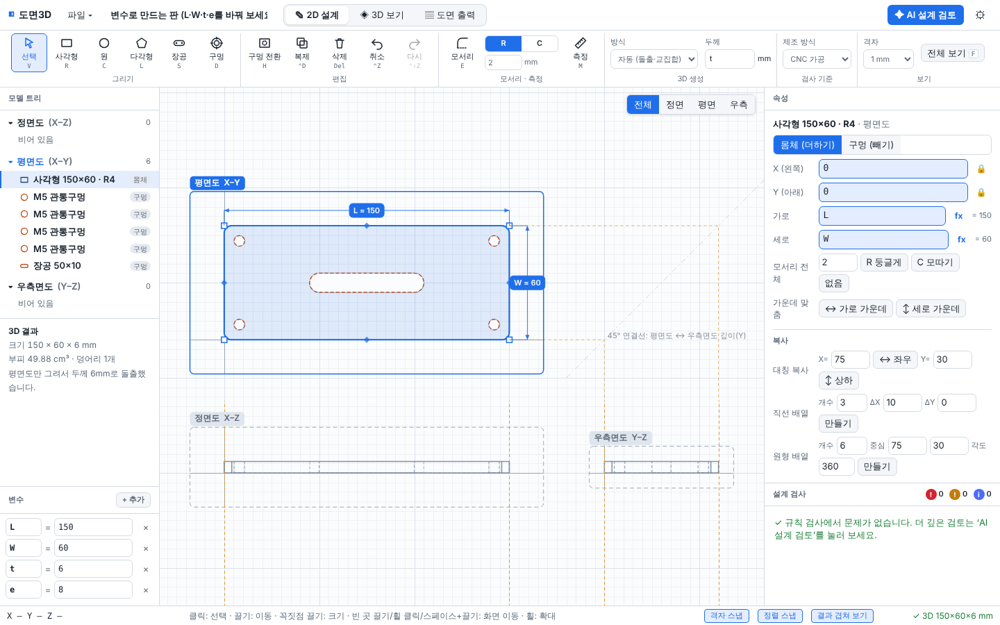

- **구속 조건** (리본 ‘구속’, 명령 찾기 “구속”, <kbd>K</kbd> 거리 치수): 대상(점·변·원, 원점과 가로·세로 축)을 차례로 누르면
  일치·동심·수평·수직·평행·직각·같게·접선·대칭·선 위·중점·고정, **치수 구속**(거리·가로·세로·각도, 값이나 변수 식) — 조건을 바꾸면 모양이 따라 바뀝니다
  - 리본 끝 **자유도 N / ✓ 다 정해짐**, 다 정해진 도형은 진한 선. 구속 기호를 눌러 고르고 Delete로 지우기, 속성 패널에 도형별 구속 목록
  - 이미 정해진 것에 또 구속하면 “중복 구속”으로 만들지 않고, 조건과 부딪치는 편집은 되돌리고 알려 줍니다
  - 해석기는 직접 만든 최소 노름 뉴턴 방식 — 끌거나 치수를 바꾸면 바뀐 값은 그대로, 나머지는 가장 적게 움직여 조건을 지킴
- **길이 단위 mm / inch**: 상태 표시줄의 **mm/inch** 단추(문서 전체, 모양은 그대로). 값 칸·식에 `10 mm`, `0.5 in`, `2"`처럼 단위를 붙일 수 있고, 단위 없는 숫자는 문서 단위.
  도면 치수·표제란·DXF도 그 단위로

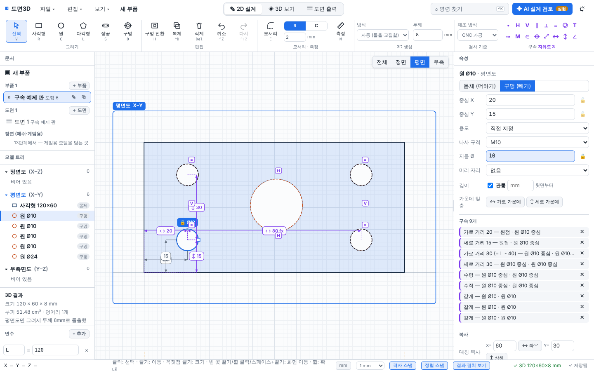
- 모델 트리, 속성 패널(숫자로 치수 수정), 실행 취소/다시 실행, 복제

### 문서: 여러 부품 · 여러 도면 (.b3d)
- 한 **문서** 안에 **부품 여러 개**와 **도면 여러 장** — 왼쪽 위 ‘문서’에서 부품을 눌러 바꿔 가며 편집, ＋ 부품, 이름(두 번 클릭)·복제·지우기 (실행 취소 가능)
- **도면은 부품을 참조**: 도면 출력에서 도면을 고르고(＋ 도면, 지우기), 도면마다 그릴 부품·용지·척도·표제란. 편집 중이 아닌 부품의 도면도 그 부품을 따로 3D로 만들어 그린다. 부품을 고치면 도면이 다시 만들어진다
- **3D 파일을 부품으로 가져오기**: STEP·STL을 지금 문서의 새 부품으로 (새 문서로 가져오기도 그대로)
- **.b3d 파일**: 문서 하나를 zip 한 파일로 — 부품·도면, 가져온 3D 파일·밑그림 원본(압축), 썸네일. 예전 `.json` 프로젝트 파일도 그대로 열린다(부품 1개 문서로)
- 장면(메쉬·게임용 모델)은 15단계에서 이 문서에 들어간다 · 예제: 파일 ▸ 예제 ▸ “문서 예제: 부품 2개 + 도면 2장”

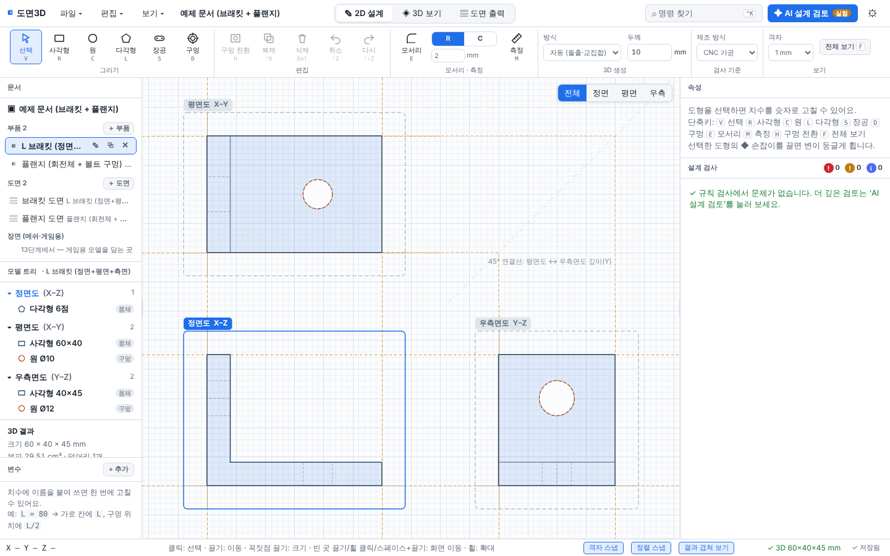

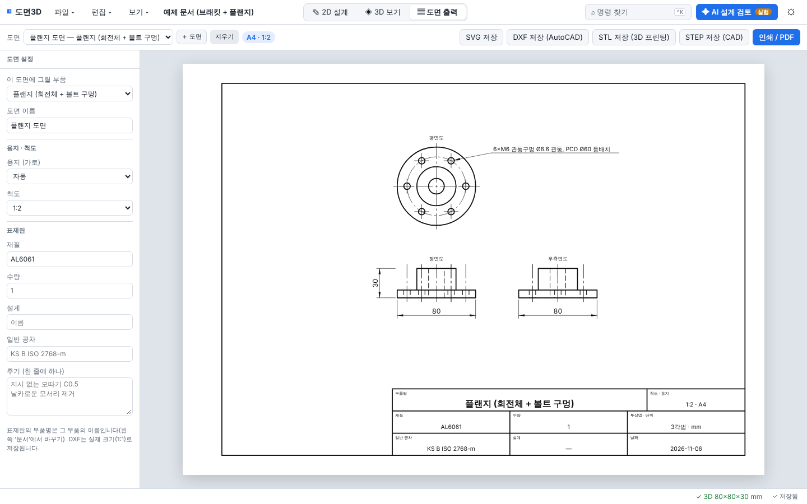

### 명령 찾기 · 단축키 · 화면 배치 · 설정
- **명령 찾기** (<kbd>Ctrl</kbd>+<kbd>K</kbd> 또는 위쪽 ‘⌕ 명령 찾기’): 이름으로 아무 기능이나 찾아 실행 — **한글 초성**(ㅅㄱㅎ → 사각형 그리기), 영어(undo, print), 띄어쓰기 없이도. 최근 쓴 것이 위로
- 모든 기능이 “명령”이라 메뉴(파일·편집·보기)·리본·단축키·명령 찾기가 같은 동작을 부른다. **한글 입력 상태에서도** 단축키가 그대로 동작
- **실행 취소 기록** (<kbd>Ctrl</kbd>+<kbd>Alt</kbd>+<kbd>Z</kbd>): 지금까지 한 일(“사각형 그리기”, “치수 고치기”…) 목록에서 원하는 단계로 건너뛰기. 바뀐 곳만 기록해서 큰 부품도 가볍다
- **화면 배치**: 패널 경계를 끌어 너비 조절, 두 번 눌러 접기(<kbd>Ctrl</kbd>+<kbd>B</kbd> 왼쪽, <kbd>Ctrl</kbd>+<kbd>Alt</kbd>+<kbd>B</kbd> 오른쪽), 좌우 바꾸기 — 그대로 저장
- **설정** (<kbd>Ctrl</kbd>+<kbd>,</kbd>): 테마(시스템/밝게/어둡게), 처음 격자, **단축키 바꾸기**(겹치면 알려 주고 정리), 실험 기능, 저장 공간, AI 키, 개발자(예제 작업 공간)

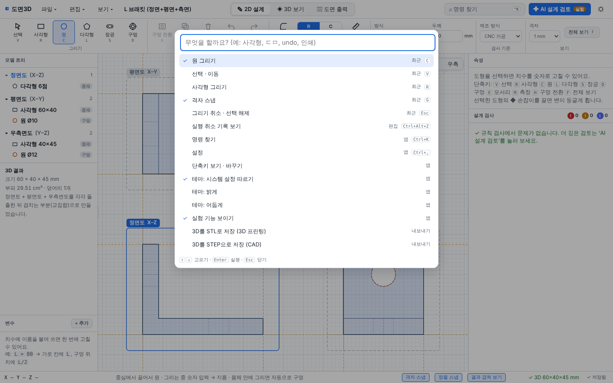

### 작업 보관 · 버전 기록 · 오프라인
- **내 프로젝트**(<kbd>Ctrl</kbd>+<kbd>Shift</kbd>+<kbd>O</kbd>): 프로젝트 여러 개를 썸네일 카드로. 열기·복제·이름 바꾸기·찾기, **휴지통**(30일 안에 되살리기)
  - 새 부품·예제·파일 열기·가져오기는 모두 **새 프로젝트**로 열리고, 앞의 작업은 그대로 남음
- **자동 저장**: 고칠 때마다 이 컴퓨터(브라우저 IndexedDB)에 저장 — 상태 표시줄 오른쪽 `✓ 저장됨`
- **버전 기록**: 고치는 동안 10분마다 자동 버전(최근 50개) + **지금 버전 저장**(<kbd>Ctrl</kbd>+<kbd>Shift</kbd>+<kbd>S</kbd>, 이름 붙이기).
  버전마다 썸네일과 "지금과 비교"(도형 몇 개 추가·삭제·바뀜, 변수, 이름…), **되돌리기**(<kbd>Ctrl</kbd>+<kbd>Z</kbd>로 취소 가능), 새 프로젝트로 꺼내기
- **전체 백업**: 모든 프로젝트·버전·3D 파일·밑그림을 파일 하나로 내보내고 가져오기 (다른 컴퓨터로 옮기거나, 브라우저 데이터를 지우기 전에)
- **안전장치**: 같은 프로젝트를 두 탭에서 열면 경고 · 다른 탭에서 고치면 "다시 불러오기" · 저장 공간이 차면 알림 · 예상 못 한 오류도 알림(작업은 이미 저장돼 있음)
- **앱으로 설치·오프라인**: 파일 ▸ 앱으로 설치(Chrome·Edge) → 바탕화면·시작 메뉴에서 바로 실행. 3D 엔진까지 미리 받아 두어 **인터넷 없이도** 그리기·3D·도면·저장이 그대로 (AI만 안 됨). 새 버전이 나오면 알림
- **파일로 저장 (.b3d)**: 다른 컴퓨터로 옮길 때 — 밑그림 이미지와 가져온 3D 파일까지 한 파일에. 설치한 앱이면 탐색기에서 .b3d·STEP·STL 파일을 바로 앱으로 열 수 있다
- 전체 백업은 zip(`.b3dbackup`) — 예전 JSON 백업보다 3배 이상 작고, 예전 백업도 그대로 가져온다

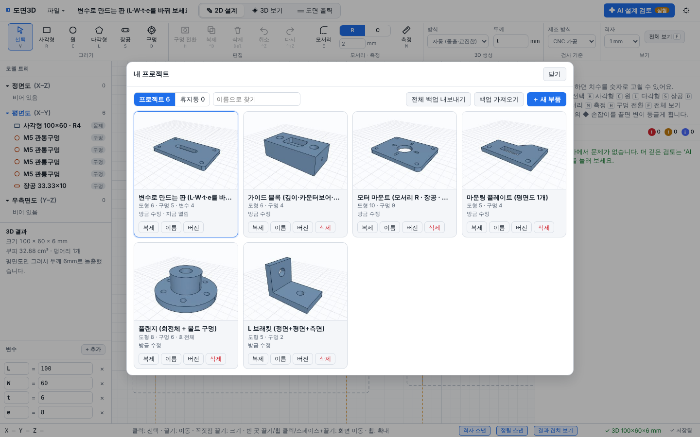

### 도면 이미지 → 3D (AI 없이 영상 처리) — 🔬 실험 기능
> 깨끗한 도면은 읽지만 손 스케치·복잡한 도면은 아직 자주 틀립니다. 제대로 "이해하는" 인식기로 다시 만드는 일은 [계획의 R1](docs/ROADMAP.md)로 미뤄 두었습니다. 설정(⚙)에서 실험 기능을 끄면 메뉴에서 숨겨집니다.

- **파일 ▸ 도면 이미지 가져오기**(<kbd>Ctrl</kbd>+<kbd>I</kbd>), 창에 끌어다 놓기, 캡처 화면 <kbd>Ctrl</kbd>+<kbd>V</kbd> — PNG·JPG·PDF
- 사진이면 종이를 찾아 **반듯하게 펴고**(원근·그림자·기울기 보정), 선 굵기로 **치수선·중심선·글자를 걸러 내고**, 3면도의 **뷰와 구멍·장공·포켓**을 찾아 3각법으로 이름을 붙인다
- 확인 창에서 뷰 이름, **척도**(용지 + 표제란 척도, 또는 아는 길이 두 점), 구멍 켜고 끄기, 회전체 여부를 고른 뒤 가져오면 바로 3D
- 가져온 도면을 제도판에 **밑그림**으로 깔아 준다 — 치수 숫자를 보며 고치기 쉽게
- 한계: 깊이(막힌 구멍·카운터보어)는 관통으로 가져오고, 1각법·단면도·손 스케치는 아직

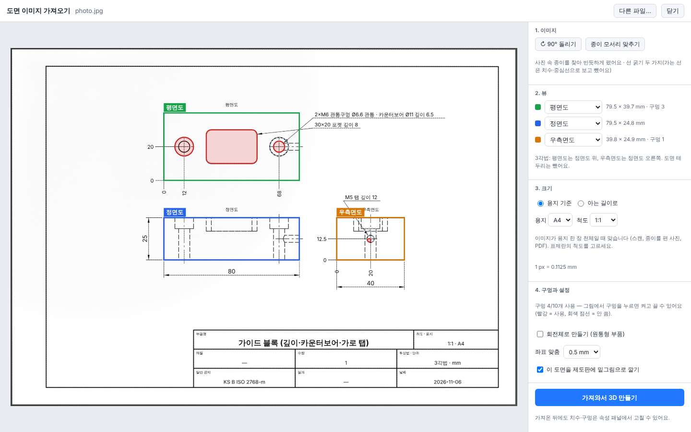

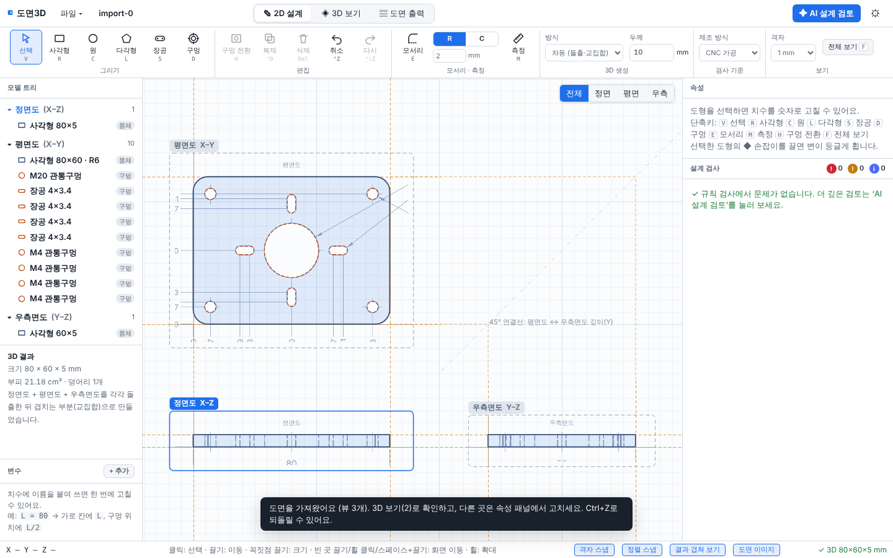

### 다른 CAD의 3D 파일 → 2D 도면
- **파일 ▸ 3D 파일 가져오기 (STEP·STL)** 또는 끌어다 놓기 → 3D 보기·3면도·DXF·인쇄가 그대로
- **STEP**은 정확한 곡면으로 숨은선까지 그리고, **형상을 읽어 치수를 다 붙임**: 단차·높이 위치, 구멍(관통·깊이·카운터보어·카운터싱크), 보스·축 Ø, 모서리 R(필렛), 모따기 C, 장공, 회전체 모서리 R. **STL**은 메쉬에서 꺾인 모서리·윤곽선을 골라 숨은선 처리
- 다른 CAD와 위쪽 방향이 다르면 위쪽 표시줄 **X ↻ Y ↻ Z ↻**로 90°씩 돌리기. 프로젝트 파일에 3D 파일도 함께 저장

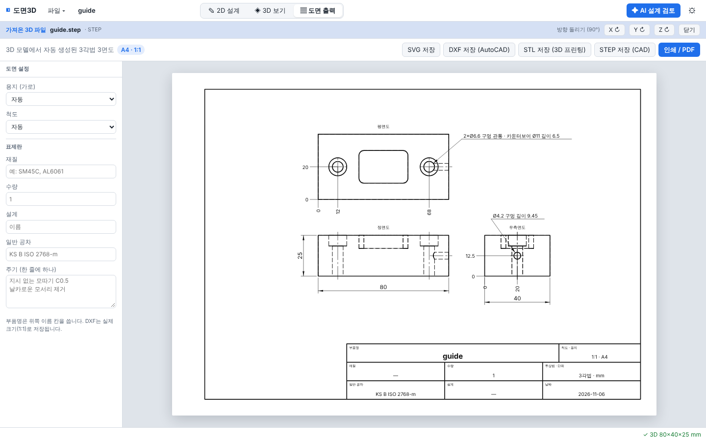

### 도면 검토 (사진·손 스케치) — 🔬 실험 기능
- 도면 이미지 가져오기 창의 **검토**: AI 없이 그림으로 알 수 있는 문제 — 뷰끼리 크기가 다름, 3각법 배치가 아님, 단면이 아닌데 빗금, 해상도 부족. 검은 바탕(태블릿)도 읽음
- **파일 ▸ 도면 검토 (AI)**: 그림 1~6장을 AI가 읽어 손글씨 치수·메모를 이해하고, 치수끼리·뷰끼리·부품끼리 **계산해서** 맞지 않는 곳, 빠진 치수, 규격(볼트·O-링) 문제, 도면 관례, 안전 문제를 알려 줌. 설계자에게 묻는 질문과 **3D 초안**도
- 결과를 누르면 그림의 해당 위치를 상자로 표시

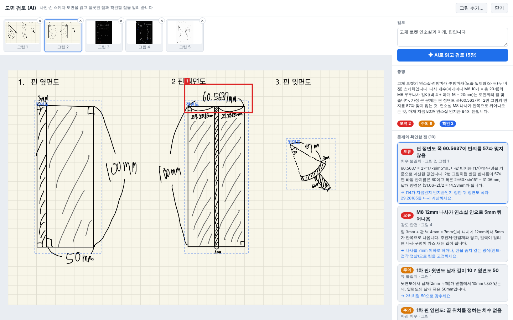

### 3D → 2D (도면 출력)
- 3각법 3면도 자동 생성: 외형선, 숨은선, 중심선, 전체 치수
- **자동 치수 2.0**: 3D 형상을 읽어 단차·높이는 그 선이 보이는 뷰에 좌표 치수(겹치면 비켜 놓기), R·C·Ø·구멍 지시는 글자·뷰와 겹치지 않는 자리에. 깊이로 정해지는 바닥은 참고 치수 “(17)”
- **치수 검사**: 모든 형상에 크기·위치 치수가 있는지 확인해 빠진 것을 왼쪽 ‘치수 검사’에 보여 줌
- **치수 직접 놓기·재기** (<kbd>D</kbd>): 점 두 개 → 가로·세로·평행 치수, 원·원호 → Ø·R, 선 두 개 → 각도. 선택(<kbd>V</kbd>)해서 끌어 옮기기, 두 번 눌러 글자 덧붙이기(±0.1, H7), <kbd>Delete</kbd> 지우기(자동 치수는 숨김) — 도면마다 저장, 실행 취소, 손가락·펜으로도
- **구멍 지시와 위치 치수**: “4×M5 관통구멍 Ø5.5 관통”, “M5 탭 깊이 12”, 카운터보어·포켓 깊이, 왼쪽 아래 기준 좌표 치수
- **볼트 원(PCD)**: 원 위에 같은 간격으로 놓인 구멍은 “6×M6 … PCD Ø60 등배치”와 볼트 원 중심선
- **용지·척도**: A4/A3/A2, 5:1~1:50 (자동이면 1:1이 들어가는 가장 작은 용지)
- **표제란**: 부품명, 척도, 재질, 수량, 3각법·mm, 일반 공차(KS B ISO 2768-m), 설계자, 날짜, 주기 — 왼쪽 ‘도면 설정’에서 고침
- 내보내기: **인쇄/PDF**(용지 한 장에 실제 척도), **DXF**(AutoCAD — 실제 크기 1:1, 원호, 레이어, 한글 안 깨짐, **치수는 AutoCAD 진짜 치수(DIMENSION)** — AutoCAD에서 DWG로 저장해도 치수로 남음), **SVG**, **STL**(3D 프린팅), **STEP**(다른 CAD)

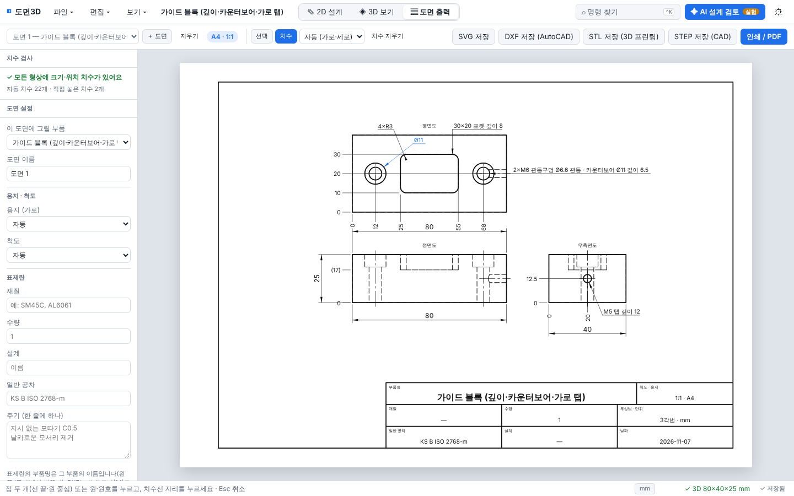

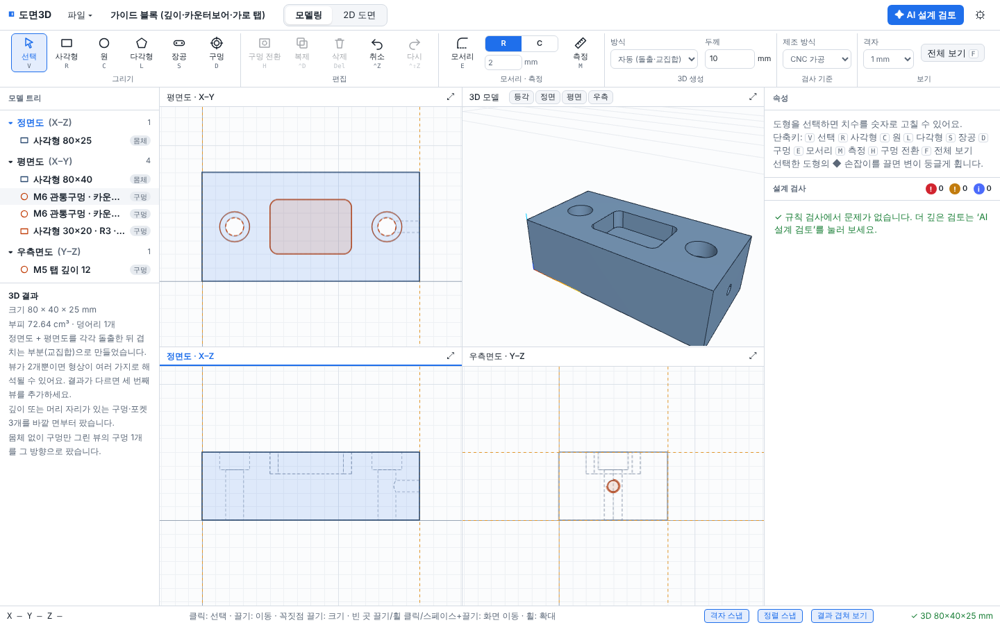

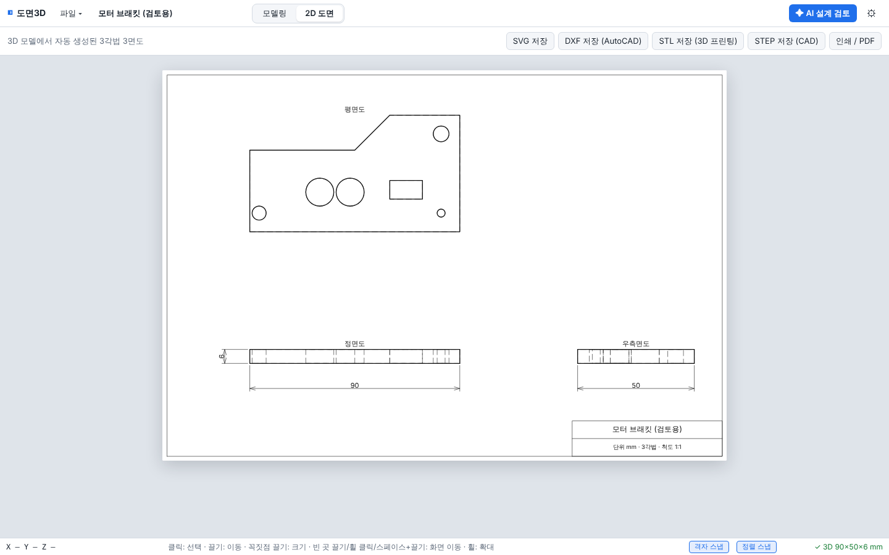

### 설계 검사 (규칙 + AI 🔬 실험)
그리는 즉시 **규칙 기반 검사**가 돌고, 필요할 때 **AI 설계 검토**를 요청합니다. 결과를 누르면 해당 도형으로 이동하고 위치가 표시됩니다.
AI를 어떻게 쓸지(클라우드 AI·로컬 모델·규칙 확장)는 아직 정하는 중이라 실험 기능으로 둡니다 → [계획의 R2](docs/ROADMAP.md).

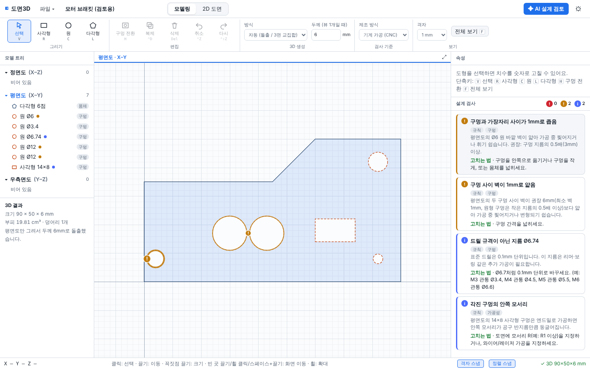

| 규칙 검사 (즉시, 무료) | AI 검토 (요청 시, Claude) |
|---|---|
| 뷰끼리 치수가 안 맞음 (예: 정면도 폭 ≠ 평면도 폭) | 뷰 사이의 모순과 의도치 않은 교집합 형상 |
| 구멍~가장자리, 구멍~구멍 벽이 얇음 | 응력 집중, 강도, 체결 구멍 배치 |
| 몸체 밖 구멍, 가장자리에 걸친 구멍(노치) | 표준 볼트/탭 규격과 어긋난 치수 |
| 너무 작은 구멍, 깊고 가는 구멍 (드릴 한계) | 대칭이 깨진 치수, 기준면이 애매함 |
| 꼬인 다각형, 아주 짧은 변, 중복 도형 | 규칙 검사가 놓친 나머지 문제 |
| 떨어진 덩어리, 판금 구멍 지름 < 두께 | 결과는 한국어 총평 + 항목별 수정 방법 |
| **제조 방식별 기준**: CNC / 3D 프린팅 / 판금·레이저 | 3면도 이미지 + 3D 렌더 + 좌표 데이터를 함께 분석 |

**AI 검토 사용법**: 오른쪽 위 ⚙ 설정에서 [Anthropic API 키](https://console.anthropic.com/settings/keys)를 입력한 뒤 **✦ AI 설계 검토**를 누르세요.
- 모델: `claude-opus-5-5`. 결과는 정해진 JSON 형식(structured output)으로 받습니다.
- 안전 분류기가 잘못 거절하면 서버가 자동으로 다른 모델로 다시 시도합니다(`fallbacks: "default"`).
- 키는 그 컴퓨터의 브라우저에만 저장됩니다. **여러 사람에게 서비스할 때는** 키를 서버에 두고 서버가 대신 호출하도록 바꿔야 합니다.

## 기술 선택

| 항목 | 선택 | 이유 |
|---|---|---|
| 실행 형태 | **웹 앱** (Chrome/Edge/Safari) | Onshape처럼 설치 없이 어느 노트북에서나 실행. 나중에 설치형이 필요하면 Electron으로 포장 (macOS에서 Tauri보다 WebGL 렌더링이 일관됨) |
| CAD 엔진 | **replicad (OpenCascade WASM)** | 정확한 원·곡면(B-rep), 숨은선 투영으로 정확한 2D 도면, STEP 지원. 메쉬 기반 엔진(manifold)은 원이 다각형이 되고 STEP 불가 |
| 3D 화면 | three.js | 가볍고 안정적 |
| 도면 이미지 인식 | **직접 만든 영상 처리** (TypeScript, 백그라운드 스레드) + PDF는 pdf.js | OpenCV.js(약 10MB) 대신 기계 도면에 맞춘 가벼운 처리(28KB). 선 굵기·3각법 배치를 이용해 AI 없이 뷰와 구멍을 읽는다 |
| AI | Claude API (`@anthropic-ai/sdk`) | 이미지와 데이터를 함께 이해하고, 구조화된 결과를 반환 |
| UI 참고 | Fusion 360, Onshape, AutoCAD, SolidWorks | 리본 도구 모음, 왼쪽 모델 트리, 오른쪽 속성 패널, 상태 표시줄 스냅 토글, 3각법 제도판 화면, 치수 직접 입력 |

## 실행

```bash
npm install
npm run dev      # http://localhost:5173
npm test         # 단위 시험 (엔진·검사·문서·파일 형식·명령·AI 요청)
npm run e2e      # 브라우저 시험 6모음 (빌드 → 미리 보기 서버 → 실행 → 요약). Playwright 필요: npx playwright install chromium
npm run build    # dist/ 생성 (오프라인용 sw.js 포함)
npm run preview  # 빌드 결과 실행 — 앱 설치·오프라인은 이걸로 확인 (개발 서버에서는 꺼 둠)
```

**인터넷에 공개하기**: GitHub 저장소 Settings → Pages → Source를 **GitHub Actions**로 바꾸면, `main`에 올릴 때마다 테스트 후 자동 배포됩니다(`.github/workflows/deploy.yml`).

## 단축키

| 키 | 동작 | 키 | 동작 |
|---|---|---|---|
| V / R / C / L / S | 선택 / 사각형 / 원 / 다각형 / 장공 | F | 전체 보기 |
| D / E / M | 구멍 / 모서리 R·모따기 / 측정 | | |
| H | 몸체 ↔ 구멍 | G / A | 격자 / 정렬 스냅 |
| Delete | 삭제 | Ctrl+D | 복제 |
| Ctrl+Z / Ctrl+Shift+Z | 실행 취소 / 다시 실행 | Ctrl+Alt+N | 새 부품 (새 프로젝트) |
| Ctrl+Shift+O | 내 프로젝트 | Ctrl+Shift+S | 지금 버전 저장 |
| Ctrl+S / Ctrl+O | 파일로 저장 / 파일 열기 (.b3d) | Ctrl+I / Ctrl+V | 도면 이미지 가져오기 / 캡처 붙여넣기 (실험) |
| **Ctrl+K** / F1 | **명령 찾기** | Ctrl+, | 설정 (단축키 바꾸기) |
| Ctrl+Alt+Z | 실행 취소 기록 | Ctrl+P | 도면 인쇄 / PDF |
| Ctrl+B / Ctrl+Alt+B | 왼쪽 / 오른쪽 패널 접기 | Ctrl+Alt+] / [ | 다음 / 이전 부품 |
| Esc | 그리기 취소 → 선택 해제 | Enter / 더블클릭 | 다각형 닫기 |
| 휠 / 핀치 | 확대 | 휠 클릭·스페이스+끌기·빈 곳 끌기 | 화면 이동 |
| 1 / 2 / 3 | 2D 설계 / 3D 보기 / 도면 출력 | K | 거리 치수 구속 (구속 도구는 리본·명령 찾기) |
| D / V (도면 출력) | 치수 놓기 / 선택(끌어 옮기기) | Delete (도면 출력) | 고른 치수 지우기 (자동 치수는 숨김) |

단축키는 설정 ▸ 단축키에서 바꿀 수 있고, 바꾸면 메뉴·리본·명령 찾기의 표시도 따라 바뀝니다.

## 폴더 구조

```
src/
  core/            화면과 무관한 순수 로직 (테스트 대상)
    types.ts         데이터 모델 (프로젝트, 도형, 뷰, 검사 결과)
    build.ts         2D 뷰 → 3D 솔리드, 3D → 투영
    checks.ts        규칙 기반 설계 검사 (제조 방식별 기준)
    expr.ts          치수 식 계산기 (안전한 파서, 단위 10 mm·0.5 in, 단위 바꾸기에서 식 고쳐 쓰기)
    params.ts        변수 계산, 치수를 식에 묶기·잠금, 이름 바꾸기, 부품 단위 바꾸기
    units.ts         길이 단위 (값은 mm, 표시·입력은 mm 또는 inch)
    solver.ts        구속 해석기 (최소 노름 뉴턴 + LM, 계수·자유도·중복 찾기)
    constraints.ts   스케치 구속 (대상·종류 16가지 → 해석기 식, 자유도·정해진 도형, 정리)
    standards.ts     나사 구멍 규격표 (볼트 관통·탭·자리파기)
    sheet.ts         투영 → 3면도 도면 (용지·척도, 중심선, 표제란, SVG, DXF + 진짜 치수)
    sheetDims.ts     도면 치수 모델 (가로·세로·평행·좌표·지름·반지름·각도·지시선) 그리기 + DXF 정의점
    autoDims.ts      자동 치수 2.0 (형상 특징 → 좌표 치수·지시, 겹치지 않는 자리 찾기, 빠짐 검사)
    features3d.ts    3D 형상 읽기 (평면·원통·원뿔·원환 → 높이·구멍·보스·R·모따기) — 워커, 자료형은 featureTypes.ts
    project.ts       저장 파일 검사·복구 (부품 하나)
    document.ts      문서 모델 (부품·도면·장면, 예전 프로젝트 변환, 부품·도면 추가·삭제, 요약·비교)
    b3d.ts           .b3d 파일(zip) 읽기·쓰기, 예전 .json 읽기, 전체 백업 zip
    bytes.ts         base64·data URL
    versions.ts      버전 요약·비교, 자동 버전 정리, 시간 표시
    mesh.ts          STL 읽기, 메쉬 3면도(숨은선: 깊이 버퍼)
    holes3d.ts       STEP 모델에서 구멍 찾기 (원통 면, 카운터보어)
    importModel.ts   STEP·STL → 3D 결과, 90° 돌리기
    vision/          도면 이미지 인식 (AI 없이 영상 처리)
      raster.ts        영상 자료형, 크기 바꾸기·회전·원근 펴기
      prep.ts          조명 고르게, 이진화, 종이 찾기, 기울기
      morph.ts         거리 변환, 깎기·불리기, 연결 요소, 채우기
      contour.ts       경계 따기, 직선·원호·원·장공 맞추기
      detect.ts        선 굵기, 가는 선 지우기, 뷰·구멍 찾기, 3각법 이름
      toProject.ts     픽셀 → mm 도형 (원점·격자·표준 지름)
      pipeline.ts      위 단계를 한 번에 (어두운 바탕 뒤집기 포함)
      checks.ts        도면 이미지 검토 (AI 없이)
    samples.ts       예제
    keys.ts          단축키 조합 (자판 위치로 읽기, 표시)
    fuzzy.ts         명령 찾기 검색 (한글 초성, 건너뛰기 일치)
    history.ts       실행 취소 기록 2.0 (바뀐 곳만, 크기 한도)
    settings.ts      설정 형식·기본값·검사
  main.ts          시작점: 모듈을 순서대로 붙이기만 (131줄)
  app/             앱 뼈대
    commands.ts      명령 시스템 (등록·단축키·찾기·겹침)
    commandUI.ts     data-cmd 단추·메뉴를 명령에 잇기 (단축키 표시, 흐림·강조)
    appCommands.ts   어디서나 쓰는 명령 (실행 취소, 설정, 테마, 내보내기, AI)
    context.ts       같이 쓰는 상태, 화면 갱신, 이벤트
    keyboard.ts      키 입력 → 명령
    menus.ts         파일·편집·보기 메뉴
    palette.ts       명령 찾기 (Ctrl+K)
    historyPanel.ts  실행 취소 기록 창
    layout.ts        패널 너비·접기·좌우 바꾸기
    settingsDialog.ts  설정 화면 (단축키 바꾸기 포함)
    prefs.ts         설정 저장·테마·실험 기능
    fileMenu.ts      파일 열기·저장, 3D 파일·도면 이미지 가져오기, 끌어다 놓기
    projects.ts      내 프로젝트·버전 기록·자동 저장 연결
    build.ts         3D 자동 생성 (0.25초 모아서)
    edit.ts          도형 편집 동작 (삭제·복제·가운데 맞춤…)
    statusbar.ts · unitsUI.ts(mm/inch 단추·명령) · lazyViewer.ts · shell.ts · notify.ts · dom.ts
  panels/          docTree.ts(문서: 부품·도면) · tree.ts · params.ts · props.ts(+consPanel 구속 목록) · findings.ts (트리, 변수, 속성, 설계 검사·AI 검토)
  consActions.ts   구속 더하기(중복 거절)·지우기·값 바꾸기
  workspaces/      작업 공간 모듈 — registry.ts(탭·숫자 키·붙이기/떼기), design.ts(+designRibbon), view3d.ts, sheet.ts(+sheetEdit 치수 편집, sheetState), example.ts(새 모듈 본보기)
  aiKey.ts         AI 모델 이름·API 키 (가벼움 — AI SDK는 쓸 때만 내려받음)
  ai.ts            Claude AI 설계 검토
  worker.ts        CAD 연산 (백그라운드 스레드)
  visionWorker.ts  도면 이미지 인식 (백그라운드 스레드)
  underlay.ts      밑그림 이미지 보관
  db.ts            IndexedDB (파일·프로젝트·버전 저장소)
  fileStore.ts     큰 파일 보관 (가져온 3D 파일, 밑그림) + 안 쓰는 파일 정리
  library.ts       프로젝트 보관함, 버전 기록, 휴지통, 전체 백업
  session.ts       지금 열린 프로젝트 ↔ 보관함 (자동 저장, 자동 버전, 썸네일, 프로젝트 바꾸기)
  tabs.ts          여러 탭에서 같은 프로젝트를 열었는지 알아채기
  pwa.ts           앱으로 설치, 오프라인(서비스 워커 등록), 새 버전 알림
  ui/libraryDialogs.ts  ‘내 프로젝트’ 창, ‘버전 기록’ 창
  aiDrawing.ts     AI 도면 읽기·검토 (손글씨 치수, 도면끼리 비교, 3D 초안)
  ui/reviewDialog.ts  도면 검토 창
  ui/importDialog.ts  도면 이미지 가져오기 창 (PDF는 pdf.js)
  engine.ts        화면 ↔ 워커 연결
  ui/board.ts      제도판: 세 뷰 배치(3각법), 화면 이동·확대, 입력 분배, 45° 연결선
  ui/sketch.ts     제도판 위의 뷰 하나 (그리기, 스냅, 치수 입력, 검사 표시)
  ui/sketchConstraints.ts  구속 고르기·기호·치수 구속 그리기 · sketchShapes.ts 도형 유틸·이름표 · sketchColors.ts 색
  ui/viewer.ts     3D 보기 (three.js — app/lazyViewer.ts가 필요할 때 내려받음)
  ui/state.ts      화면 상태 (도구, 선택, 카메라, 커서)
  ui/modal.ts      가운데 뜨는 창 틀
public/            앱 아이콘, manifest.webmanifest (설치 정보)
vite.config.ts     빌드 설정 + 오프라인용 sw.js 만들기
tests/             vitest 단위 시험
e2e/               브라우저 시험 (run.cjs가 한 번에: core · app · library · document · import3d · legacy · constraints · units · dims)
scripts/check_dxf.py  DXF 검사 (ezdxf로 읽기·검사, 치수 요약) — 단위 시험이 씀
```

## 개발 순서

트랙(작업 기반 → 앱 구조 → 문서 모델 → 스케치·피처 → 도면 → 메쉬·게임 → 조립·렌더·제조 …)을 순서대로 쌓습니다.
각 단계는 시작하기 전에 세부 단계와 완료 기준을 적고, 끝나면 [완료 기록](docs/CHANGELOG.md)에 옮깁니다. 새 아이디어는 [아이디어 함](docs/IDEAS.md)에 먼저 넣고 계획에 배치합니다.
전체 계획과 지금 위치는 [docs/ROADMAP.md](docs/ROADMAP.md)를 보세요.
